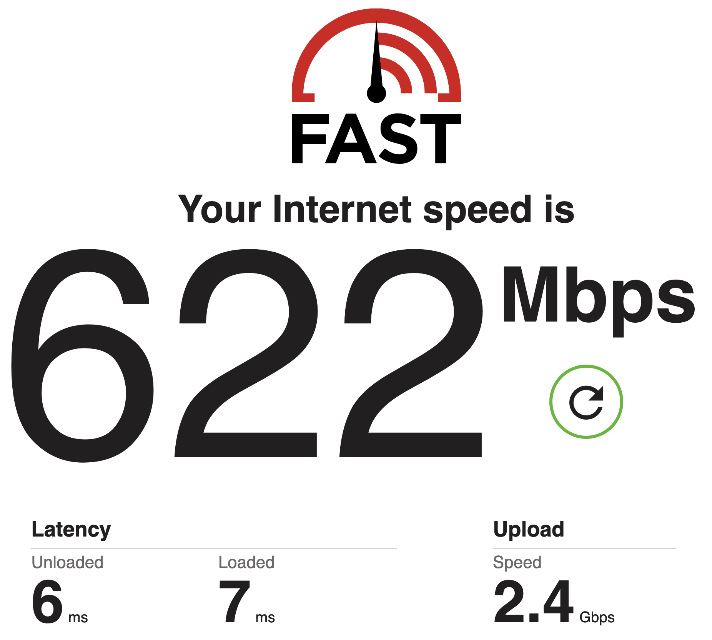
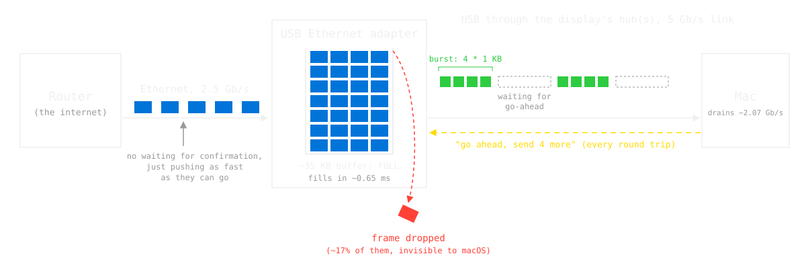
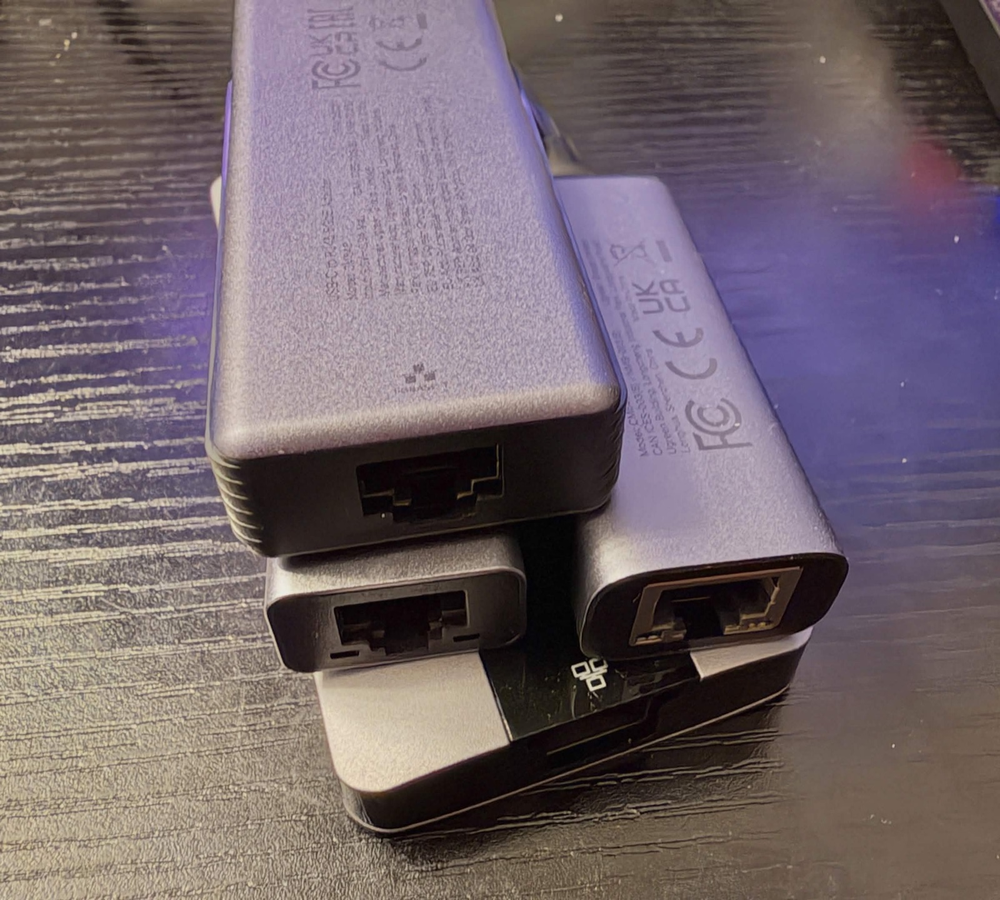

Somehow I am one of those few very lucky people to have the opportunity of owning a 2.5 gig symmetrical line for my internet. But one day, when I wanted to brag to my equally nerdy friends, shock and horror: 600 Mbps down? Luckily my upload speed was still 2.4 Gbps, so I didn't lose all my bragging rights, but that's weird, right? If anything, you'd expect the opposite!



My ISP is pretty cool. It's run by this one guy (Hey Keith!), and I know I can always message them and they respond promptly, as they did this time. We tried to run through a few debugging steps, they checked on their end, and everything was normal. I tried my work laptop too, same speed.

I didn't have time for debugging, because I needed to travel 2000 km to the other side of the continent for a family emergency.


But as soon as I got back, I got curious again. What could it be? In retrospect, I now know when it started: when I moved all my connections onto my [Studio Display XDR](/posts/studiodisplayxdr/). I wanted to have a one-cable setup, and the monitor offered me that. I've had it for half a year now, and I don't think I've ever run a speed test through it. 600 Mbps was more than fast enough for me to never realise I wasn't getting three quarters of the speed I was paying for 🤦

## The setup

- MacBook Pro M3 Pro
- 2026 Studio Display XDR, with everything plugged into it so switching laptops is one cable
- UGREEN USB-C to 2.5G Ethernet adapter, plugged into the display
- UniFi Dream Router 7, the same one from my [WiFi 7 debugging post](/posts/wifi7speedhunt/)

## What I thought was interesting

Pings to other wired computers during a download would fail 10% of the time over Ethernet through the adapter plugged into my screen, and 0% of the time over Wi-Fi. What made it stranger was that there were no dropped frame errors in macOS's logs at all. This was the big hint for me: the adapter was dropping them before the computer could know.

I then plugged the adapter straight into my Mac instead of the monitor, and ran an iperf3 server on my UDR 7: 2.3 Gbps. So the cable, the router and the adapter are all fine? What about fast.com? Perfect speeds there too! 2.2 down and 2.3 up when connected straight in. As soon as I connected it to the display, it was back to 600 down again.

So it's the display, right? Well, I would find out: sort of yes, sort of no, which is why I wanted to write this blog post. I couldn't find anything online explaining the exact cause, and it's quite a cool reason.

## The driver and flow control

The adapter uses a Realtek RTL8156B, which on macOS binds to Apple's generic USB networking driver. But Realtek ship [their own driver on their website](https://www.realtek.com/Download/List?cate_id=585), so I thought I'd give that a go! I installed it and, to my surprise, it almost doubled the download speed to 1.1 Gbps, but that was still nowhere close to 2.5. First hint that it couldn't just be the monitor's fault.

Then I tried [flow control](https://en.wikipedia.org/wiki/Ethernet_flow_control). I had never truly looked into this before, and I think it's quite neat to know about if you were also ignorant of it like me. Basically, when a device receives Ethernet frames it can't keep up with, it just drops them. With flow control (it's something your router or switch has to support), it can send the sender a "pause" frame, and the sender then buffers the data on its side, instead of the receiver (the adapter in this case) on its side. I turned it on in my UniFi console and guess what, download jumped to around 2 Gbps, with upload still at full speed! Yay! Well, not so fast...

I don't like it always being on, because it can add latency to other systems like my gaming PC. Can you work around it? For sure, you can disable it on those computers, but it's janky, and it's another thing I need to remember when my [Sauerbraten](http://sauerbraten.org/) game starts lagging. I need fewer things to remember, considering I am 30 in a couple of months. My memory is not what it used to be.

## But the upload was always fine

Yeah, isn't that weird? First of all, it looks like the port can indeed do 2.5 in both directions. I already knew that, because I get much more than that from my external SSD through the monitor's Thunderbolt port. So the issue is not the monitor again? But it has to be!

Well, I had another idea. How about I connect to my Linux box, which is also on 2.5, and send perfectly smooth UDP traffic at a fixed rate with flow control off? Then I can check the chip's own counter of dropped frames:

| Sent | Lost behind the display | Frames/s reaching the Mac behind the display | Lost direct on the Mac |
|---|---|---|---|
| 1.46 Gbps | 0% | 123,800 | 0% |
| 1.75 Gbps | 0.05% | 148,600 | 0% |
| 1.94 Gbps | 0.1% | 165,000 | 0% |
| 2.03 Gbps | 2.7% | 168,000 | 0% |
| 2.12 Gbps | 7.2% | 168,000 | 0% |
| 2.20 Gbps | 10.5% | 168,000 | 0.001% |
| 2.28 Gbps | 13.5% | 168,000 | 0.02% |

So basically no drops whatsoever when connected straight to my Mac, but loads of drops after about 168k frames per second (roughly 2 Gbps). Remember that number. That number comes from the adapter's own counters: however much I sent, the number of frames it managed to hand over to the Mac each second flattened out at about 168,000, and everything above that was dropped.

Why did this not happen on my SSD? What was the only difference I could find? Bursts!

When the Mac reads data from a USB 3 device, the device sends some packets, then has to wait for the Mac to say "lgtm, send more!". The SSD enclosure sends 16 packets before needing a go-ahead message back. The RTL8156B in my Ethernet adapter sends 4.

Here is a diagram of my best understanding of why this is an issue. I made this diagram 100 times, and I think I can probably improve it more, but if it helps you understand the issue, I have done my job.



As you can see, the speed of packets coming into the adapter is 2.5 Gbps. That's what the router pushes in. The speed going out is around 2 Gbps. The reason is that if you add up the average time it takes to get the go-ahead through my monitor's hub, which is around 7.6 µs, to the average time it takes to send 4 KB, around 8.2 µs, you can find what the maximum speed is.

Well, if the speed of the drain from my adapter to my Mac is half a gig slower than the speed of the input, then you can imagine the buffer getting filled more and more until it overflows. Those are dropped packets, which result in a hard backoff when the router resends them, so you drop loads in speed. And that's the reason for all of this.

## OK, well, what now?

I have a cupboard full of USB-C Ethernet adapters. Don't ask.



The problem is they're all 1 gig adapters, so any of the tests I made would not tell me anything, because the issues don't start at 1 gig. They start at around 2... If I run my 2.5 gig adapter at 1 gig speeds, I get 1 gig downloads with the official driver. If I run it at 1.5, I get 1.5. If I run it at 2, well, I get 1...

So I thought I would do what any human would do, and I spent more money on a new adapter. Another UGREEN, but this time it's one that promises 5 Gbps and uses the RTL8157 chip instead: [UGREEN 5G USB-C Ethernet adapter](https://link.amazon/B0bgEABbc). My reasoning was that if this one could get me better speeds, it would help me understand how. And that it did!

With this adapter, I dropped 0 frames:

| Sent | Frames/s reaching the Mac | Dropped by the adapter |
|---|---|---|
| 1.5 Gbps | 124k | 0 |
| 1.9 Gbps | 157k | 0 |
| 2.1 Gbps | 173k | 0 |
| 2.3 Gbps | 187k | 0 |
| 2.4 Gbps | 194k | 0 |

Why? Well, looking through what each adapter tells me about itself:

```
$ python3 -c "import usb.core; e = usb.core.find(idVendor=0x0bda)[0][(0,0)][0]; print('packet size', e.wMaxPacketSize, 'bMaxBurst', e.extra_descriptors[2])"

# old adapter (RTL8156B)
packet size 1024 bMaxBurst 3

# new adapter (RTL8157)
packet size 1024 bMaxBurst 7

# bMaxBurst counts the packets after the first one, so 3 means 4 packets and 7 means 8
```

I can see that instead of sending 4 1 KB packets per burst, it would send 8! And the speed of the link was also 2x faster, so those 8 KB would go 2x faster to the Mac. That means the time spent was 8 times lower to send the same data, and while the wait for the go-ahead was identical, the theoretical speed from the adapter to the Mac, including the wait for the go-ahead, was a maximum of 4.5 Gbps. That's much bigger than the 2.5 coming into the adapter, so the buffer would never fill up, packets would never drop and everything was great, even if the "go-ahead" response was still much slower than when connected directly to the Mac.

## Final thoughts

I think the big takeaway from this is that all the things you think are quite easy to understand, such as transfer speeds, have so many cool intricacies that it's worth diving deep every so often. Who would've thought that the speed of the link between the adapter and the Mac was defined not only by the link speed itself in Gbps, but also by the time it took your Mac to reply, by the amount of packets, by the speed of those packets, by the number of packets in a burst, and by the size of those packets?

See you next time, when I will spend just as much time on another trivial thing that we can all learn from!
